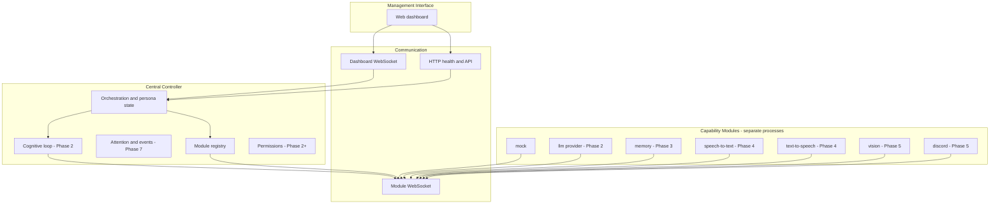

# ECHO Architecture

ECHO is a modular runtime for a single persistent AI persona. Capabilities run as independent processes that connect to a **central controller** over a versioned WebSocket protocol. The controller orchestrates persona state, attention, and (in later phases) the cognitive loop; it never executes provider-specific or GPU-heavy work directly unless configured as an in-process adapter.

## Technology choices

| Area | Choice | Rationale |
|------|--------|-----------|
| Language | TypeScript (Node 20+) | Strong typing for protocol contracts, good WebSocket ecosystem, fast iteration |
| Controller HTTP/WS | Fastify + `@fastify/websocket` | Lightweight, explicit routes, production-friendly |
| Protocol validation | Zod (`@echo/protocol`) | Single source of truth for schemas; usable from modules and controller |
| Module client | `@echo/module-sdk` | Reconnect, registration, heartbeats, request handlers |
| Dashboard | React + Vite | Separated UI, real-time updates via dashboard WebSocket |
| Config | YAML + env overrides | Self-host friendly; secrets via `ECHO_*` env vars |
| Memory persistence | PostgreSQL (memory module) | Authoritative store; controller has no DB access |
| Tests | Vitest | Fast unit/integration tests with mock modules |

Trade-offs: Node is not ideal for every module (e.g. native ML). The **protocol is language-agnostic** so Python/Rust modules can be added later. We avoid message brokers and microservice frameworks until cross-machine load justifies them.

## Layered system



## Repository layout

```
ECHO/
  apps/
    controller/     # Central controller (HTTP + module WS + dashboard WS)
    web/              # Management dashboard
  packages/
    protocol/       # Versioned message schemas and constants
    module-sdk/     # Module-side WebSocket client
  modules/
    mock/           # Reference / test module
  docs/
    ARCHITECTURE.md
    protocol/
      WEBSOCKET_PROTOCOL.md
  config.example.yaml
```

## Controller responsibilities (phased)

**Phase 1 (implemented):** Module registration, heartbeats, capability discovery, health/degraded detection, system snapshot API, real-time dashboard feed, structured logging hooks, event log for operator visibility.

**Phase 2 (implemented):** `@echo/llm` provider interface (OpenRouter default + OpenAI-compatible local GPU servers), `ProviderRegistry`, cognitive loop with module tool routing, SSE chat API, dashboard conversation UI.

**Phase 3+:** Memory module integration, voice, vision, Discord, distributed auth, autonomy policies.

## Persona state

**ECHO** is the runtime backend; a **character card** is the editable persona the LLM embodies (name, appearance, personality, mannerisms, speech style, reference images, and behavioral notes). Cards are stored as JSON under `data/characters/`; exactly one **active** card is tracked in `data/active-character.json`. The cognitive loop builds a layered system prompt from the active card plus runtime policy from config (for example `persona.reactiveOnly` and global behavioral guidelines).

**Operational state** (activity, focus, channel, pending actions, active model/provider) lives in the controller and is exposed on the dashboard snapshot. Durable memories will be owned by the memory module, not the character card text.

REST API: `GET/POST /api/v1/characters`, `GET/PATCH/DELETE /api/v1/characters/:id`, `PUT /api/v1/characters/active`. The dashboard **Characters** view manages cards and activation; chat uses the active character’s name and system prompt.

## Distributed execution

From Phase 1, modules only need a WebSocket URL and optional auth token. Host metadata is reported at registration. Phase 6 adds pairing, TLS/WSS, and media-by-reference. The controller remains the coordination point; large payloads should not flow through it when avoidable.

## Security defaults

- Module connections may require a shared secret (`ECHO_MODULE_AUTH_TOKEN`).
- Model output is treated as untrusted; tool execution requires module verification (Phase 2+).
- Autonomy defaults to **reactive-only** (`persona.reactiveOnly: true`).
- Administrative HTTP is bound to localhost by default in sample config.

## Major risks and open decisions

1. **SQLite vs PostgreSQL** for multi-host writes — start SQLite single-node; revisit if multiple controllers ever share memory.
2. **In-process vs module LLM adapter** — interface first; default in-process for Phase 2 with the same contract as remote modules.
3. **Media transport** — references + signed URLs vs dedicated media channel (Phase 5/6).
4. **Discord voice latency** — depends on STT/TTS placement on LAN; needs measurement in Phase 5.

## Phase 1 acceptance criteria

- [x] Architecture and protocol documented
- [x] Controller listens for module and dashboard WebSockets
- [x] Mock module registers in a separate process
- [x] Dashboard shows live module status
- [x] Automated tests for protocol and registration flow

## Phase 2 acceptance criteria

- [x] Common LLM provider interface (`@echo/llm`)
- [x] OpenRouter and OpenAI-compatible local adapters
- [x] Context assembly, character system prompt, bounded tool loop
- [x] Streaming chat (SSE dashboard; token streaming over module `stream.chunk` when using LLM module)
- [x] Cancel in-flight requests (dashboard + module `cancel`)
- [x] Usage reporting (event log + chat UI token count)
- [x] Interactive dashboard conversation (LLM module or `cognition.llmAdapter: embedded`)
