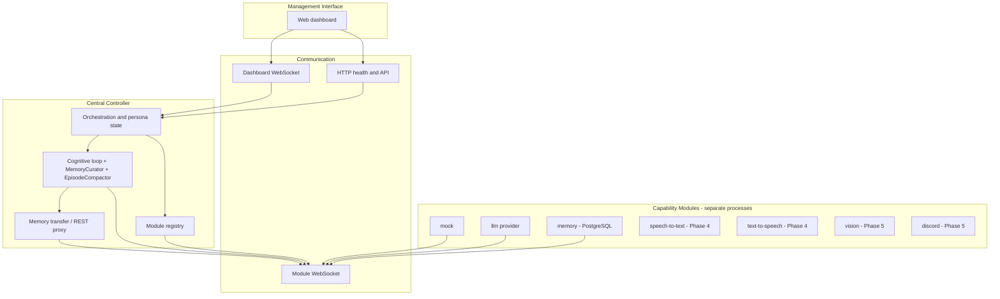

# ECHO Architecture

ECHO is a modular runtime for a single persistent AI persona. Capabilities run as independent processes that connect to a **central controller** over a versioned WebSocket protocol. The controller orchestrates persona state, the cognitive loop, and memory orchestration; it never executes provider-specific or GPU-heavy work directly unless configured as an in-process adapter.

## Technology choices

| Area | Choice | Rationale |
|------|--------|-----------|
| Language | TypeScript (Node 20+) | Strong typing for protocol contracts, good WebSocket ecosystem, fast iteration |
| Controller HTTP/WS | Fastify + `@fastify/websocket` | Lightweight, explicit routes, production-friendly |
| Protocol validation | Zod (`@echo/protocol`, `@echo/memory-contract`) | Single source of truth for schemas |
| Module client | `@echo/module-sdk` (TS) / Python WS client (memory) | Reconnect, registration, heartbeats, request handlers |
| Dashboard | React + Vite | Separated UI, real-time updates via dashboard WebSocket |
| Config | YAML + env overrides | Repo-root `config.yaml`; secrets via `ECHO_*` env vars |
| Memory persistence | PostgreSQL + pgvector (memory module) | Authoritative store; controller has no DB access |
| Tests | Vitest (TS), pytest (memory) | CI runs controller tests + Postgres-backed memory tests |

Trade-offs: Node is not ideal for every module (e.g. native ML). The **protocol is language-agnostic** — the memory module is Python with sentence-transformers for local embeddings. We avoid message brokers until cross-machine load justifies them.

## Layered system



## Repository layout

```
ECHO/
  apps/
    controller/       # Central controller (HTTP + module WS + dashboard WS)
    web/                # Management dashboard
  packages/
    protocol/           # Versioned message schemas
    memory-contract/    # Memory capability schemas
    llm/                # Provider interface
    module-sdk/         # Module-side WebSocket client
  modules/
    mock/               # Reference / test module
    llm/                # LLM provider module
    memory/             # Phase 3 memory module (Python, Alembic, pgvector)
  docs/
    ARCHITECTURE.md
    PHASE3_MEMORY.md
    protocol/
  config.yaml           # Local config (controller + memoryModule sections)
  docker-compose.yml    # PostgreSQL for development
```

## Controller responsibilities (phased)

**Phase 1 (implemented):** Module registration, heartbeats, capability discovery, health/degraded detection, system snapshot API, real-time dashboard feed, structured logging hooks, event log.

**Phase 2 (implemented):** `@echo/llm` provider interface, cognitive loop with module tool routing, SSE chat API, dashboard conversation UI, character cards.

**Phase 3 (implemented):** Memory module integration — durable conversations, hybrid retrieval (FTS + local embeddings), auto-extraction via **MemoryCurator**, rolling **EpisodeCompactor**, operator Memory tab (search, promote, correct, jobs), dual-module **transfer**, chat session hydration from Postgres (`GET /api/v1/chat/history`), config-driven retrieval budgets.

**Phase 4+:** Voice (STT/TTS), vision, Discord/Twitch integrations, distributed auth, autonomy policies, attention (Phase 7).

## Persona state

**ECHO** is the runtime backend; a **character card** is the editable persona the LLM embodies. Cards live under `data/characters/`; the active card is tracked in `data/active-character.json`. The cognitive loop builds a layered system prompt from the active card plus runtime policy from config.

**Operational state** (activity, focus, channel, pending actions, active model/provider) lives in the controller and is exposed on the dashboard snapshot.

**Durable memory** (semantic, episodic, procedural facts, episode summaries, conversation logs) is owned by the memory module keyed by **persona id** (= active character UUID). The dashboard chat keeps a stable **session id** per character in localStorage and reloads verbatim history from the memory module after refresh or controller restart.

REST API highlights: characters CRUD, `POST /api/v1/chat` (SSE), `GET /api/v1/chat/history`, `GET/POST /api/v1/memory/*`, `POST /api/v1/memory/transfer`.

## Distributed execution

Modules only need a WebSocket URL and optional auth token. Host metadata is reported at registration. Phase 6 adds pairing, TLS/WSS, and media-by-reference. Large payloads should not flow through the controller when avoidable.

## Security defaults

- Module connections may require a shared secret (`ECHO_MODULE_AUTH_TOKEN`).
- Model output is treated as untrusted; tool execution requires module verification.
- Autonomy defaults to **reactive-only** (`persona.reactiveOnly: true`).
- Administrative HTTP is bound to localhost by default in sample config.

## CI

GitHub Actions (`.github/workflows/ci.yml`) runs controller typecheck/tests and memory module pytest against PostgreSQL with pgvector.

## Major risks and open decisions

1. **Multi-controller writes** — one controller per deployment today; shared Postgres across controllers is untested.
2. **In-process vs module LLM adapter** — both supported via `cognition.llmAdapter`.
3. **Media transport** — references + signed URLs vs dedicated media channel (Phase 5/6).
4. **Discord voice latency** — depends on STT/TTS placement; needs measurement in Phase 5.

## Acceptance criteria (summary)

| Phase | Status |
|-------|--------|
| 1 — registry, dashboard, mock module | Done |
| 2 — LLM, chat, characters | Done |
| 3 — Postgres memory, retrieval, curator, episodes, transfer | Done |
| 4 — voice | Planned |
| 5 — vision, Discord | Planned |
