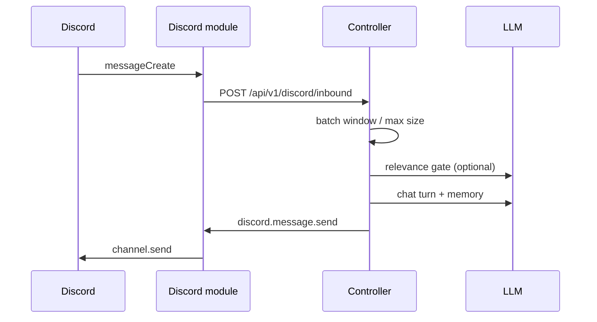

# Discord integration

ECHO connects to Discord through a **Discord module** (`modules/discord`) and a **controller orchestrator** that batches messages, applies a persona relevance gate, runs the same cognitive + memory pipeline as dashboard chat, and sends replies back.

## Components

| Piece | Role |
|--------|------|
| **Web → Discord tab** | Bot token, guild id, per-channel text/voice flags, batching and voice policies |
| **`data/discord/settings.json`** | Persisted settings (token stored on disk — protect the `data/` directory) |
| **`DiscordOrchestrator`** | Debounce/batch inbound messages, LLM gate, `CognitiveEngine.chat`, outbound send |
| **Discord module** | discord.js client, inbound HTTP to controller, capability handlers for send/voice |

## Text chat flow

- **Session id** for memory: stable UUID per **text channel** (`discordTextSessionId`) and a separate id per **voice channel** (`discordVoiceSessionId`) so text chat and voice STT turns do not share history or TTS.
- **Text replies** never use sentence TTS; **voice STT** replies use the TTS pipeline only (LLM cannot call `tts.speech.*` or `discord.voice.speak` on text turns).
- **Speaker key**: `discord:{guildId}:{userId}` for Phase 3 memory participants.
- **Always respond** when the bot is @mentioned or the user replies to the bot’s message.
- **Relevance gate** (default on): small structured LLM pass using the active character card — skips side chatter the persona would ignore.
- **Per-message gate**: each inbound message gets a relevance check (unless @mention / reply-to-bot).
- **Skipped backlog**: messages the persona ignores are kept (default cap **12**) and included in the **next** reply when they choose to speak.

## Voice join failures (“operation was aborted” at ~20s)

If the Events log shows `discord.voice.join failed: The operation was aborted` about **20 seconds** after `tool.start`, that is usually **`@discordjs/voice` timing out** while waiting for `VoiceConnectionStatus.Ready` — not the dashboard cancelling chat.

Checklist:

1. Bot role: **Connect** + **Speak** on the voice channel.
2. **UDP** outbound allowed (Windows firewall / VPN) — Discord voice uses UDP after the gateway handshake.
3. Discord module deps: **encryption** + **opus** (`pnpm install` from repo root). Under pnpm, voice encryption uses **`@stablelib/xchacha20poly1305`** (ESM `libsodium-wrappers` is unreliable). On boot the discord module logs a **Voice dependency report** — `@stablelib/xchacha20poly1305` should show a version, not `not found`.
4. Discord module console: **`signalling`** then hang/`destroyed` without **`ready`** often means **UDP blocked** (firewall/VPN) after voice WS setup; **`connecting` → `signalling`** only with no `ready` matches that pattern.
5. Look for `[discord] voice connection state → …` or `voice connection destroyed … reason=`.

ECHO uses a **60s** Ready wait and returns an explicit error if Ready is never reached.

## Voice (v1 scaffold)

| Feature | Status |
|---------|--------|
| Auto-join voice-enabled channels | Implemented |
| Barge-in (stop bot when humans speak) | Implemented (simulated speech duration until TTS audio is wired) |
| Interrupt annoyance reaction | Implemented after N interrupts (config threshold) |
| STT per speaker | **Implemented** — Discord streams PCM to `pnpm dev:stt`; transcripts hit `/api/v1/discord/voice/transcript` (see [STT.md](./STT.md)) |
| TTS playback | **Implemented** — TTS module synthesizes → controller routes to `discord.voice.speak` with `audioBase64`; Discord module plays via `@discordjs/voice` + FFmpeg (wav/mp3) |

The Discord module **never talks over humans**: when someone speaks while output is active, playback is cancelled and the controller is notified via `/api/v1/discord/voice/interrupt`. Before starting a voice reply, ECHO waits for the channel to be quiet (Discord speaking map + active STT capture); if someone is still talking, the LLM turn is deferred and TTS chunks are not played until silence returns.

## Versions

The Discord module tracks current **discord.js** and **@discordjs/voice** releases (see `modules/discord/package.json`). As of the latest ECHO stack:

| Package | Role |
|---------|------|
| `discord.js` ^14.27 | Gateway client, messages, voice state |
| `@discordjs/voice` ^0.19 | Voice connect, receive, playback (includes **DAVE** via `@snazzah/davey`) |
| `@discordjs/opus` | Preferred opus codec |
| `opusscript` | Opus fallback (pure JS) |
| `@stablelib/xchacha20poly1305` | Voice encryption fallback when libsodium ESM fails under pnpm |

**Node.js ≥ 22.12** is required for `@discordjs/voice` 0.19 (`node -v` before `pnpm dev:discord`).

## Setup

1. Create a [Discord application](https://discord.com/developers/applications) and bot.
2. **Required for full text chat:** Developer Portal → **Bot** → **Privileged Gateway Intents** → enable **Message Content Intent** → **Save Changes**. Without this, Discord closes the connection with `Used disallowed intents` unless ECHO **mentions only mode** is enabled (Dashboard → Discord).
3. Invite the bot to your guild with permissions: View Channels, Send Messages, Connect, Speak.
4. Run stack: `pnpm dev`, `pnpm dev:discord`, plus LLM and memory as usual.
5. Open **Discord** in the dashboard: paste token, guild id, channel ids, save.
6. Set `ECHO_MODULE_AUTH_TOKEN` in `.env` (controller + modules) so inbound HTTP is authenticated.

### Rate limit (429) on token check or login

Discord applies a **global** rate limit across REST and gateway. During development, the earlier **reconnect loop** (config re-applied on every heartbeat) could fire dozens of logins in a minute. ECHO also called `GET /users/@me` on **every** reconnect, which made 429s more likely.

ECHO now **caches** successful token checks for 30 minutes and **backs off** using Discord’s `Retry-After` when you hit 429. Stop `dev:discord`, wait for the time shown in the log (often 60–600s), then start once — avoid saving Discord settings repeatedly while limited.

### Gateway login timed out but REST works

If the module log shows `Token OK for @…` then `Gateway connect failed: … gateway did not become ready`, HTTPS to Discord works but the **gateway WebSocket** is blocked or rate-limited. Allow outbound **WSS** (often `gateway.discord.gg`), disable VPN/proxy tests, or wait 1–2 minutes after many reconnects.

Optional env:

| Variable | Default |
|----------|---------|
| `ECHO_CONTROLLER_HTTP` | derived from `ECHO_CONTROLLER_MODULE_WS` |
| `ECHO_DISCORD_MODULE_ID` | `discord-module-1` |

## Security

- Bot token lives in `data/discord/settings.json`; do not commit `data/`.
- Inbound routes require `Authorization: Bearer <ECHO_MODULE_AUTH_TOKEN>` when the token is set on the controller.

## Next steps

- Implement **STT** and **TTS** modules against `@echo/voice-contract`.
- Wire opus/pcm decode in `discord.voice.speak` for real audio playback.
- Multi-guild support and slash-command controls.
