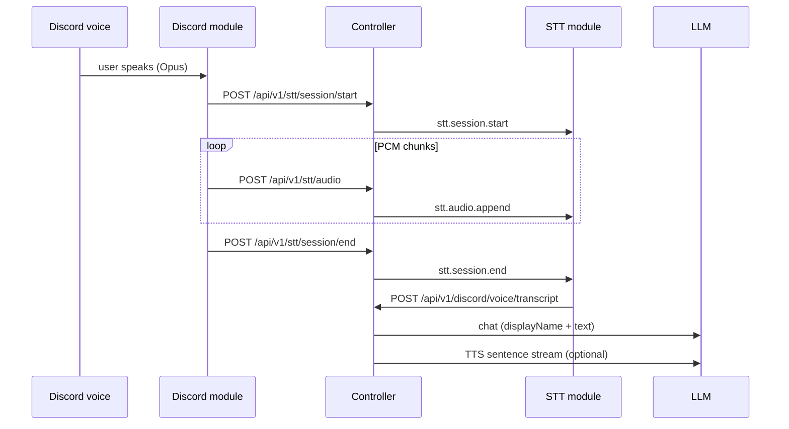

# STT module

When the Discord bot is in a voice channel and the STT module is connected, user speech is decoded to PCM, streamed to the STT module, transcribed, and delivered to the cognitive engine as a **normal Discord-shaped chat turn** (same session and `discord:{guild}:{user}` speaker as text chat). Replies use the existing TTS pipeline when the TTS module is connected.

## Flow



## Run

```bash
pnpm dev
pnpm dev:discord
pnpm dev:stt
pnpm dev:tts   # optional, for spoken replies
```

Set `ECHO_MODULE_AUTH_TOKEN` on the controller and all modules.

## Transcription providers (free-first)

| Provider | Config | Notes |
|----------|--------|--------|
| **local-http** (default) | `transcriptionBaseUrl` → OpenAI-compatible `/audio/transcriptions` | Run [whisper.cpp server](https://github.com/ggerganov/whisper.cpp), [speaches](https://github.com/speaches-ai/speaches), or similar locally — no API cost |
| **groq** | `GROQ_API_KEY` or `groqApiKey` in settings | Free tier Whisper (`whisper-large-v3-turbo`) |

Default local URL: `http://127.0.0.1:8091/v1` (ECHO Whisper server — see [VOICE_SERVERS.md](./VOICE_SERVERS.md))

```bash
# Example: put in .env for Groq instead of local
GROQ_API_KEY=gsk_...
```

Apply at runtime:

```http
PUT /api/v1/stt/settings
{ "provider": "groq" }
```

## API

- `GET /api/v1/stt/status` — module connection
- `PUT /api/v1/stt/settings` — partial STT config
- `POST /api/v1/stt/session/start|end` and `/audio` — used by the Discord module (Bearer auth)

## Discord requirements

- Channel **voice enabled** in dashboard Discord settings
- **autoJoinVoice** (or manual `discord.voice.join`)
- Bot **Connect** + **Speak** permissions
- Opus decode uses pure-JS `opusscript` (no native compile required)
