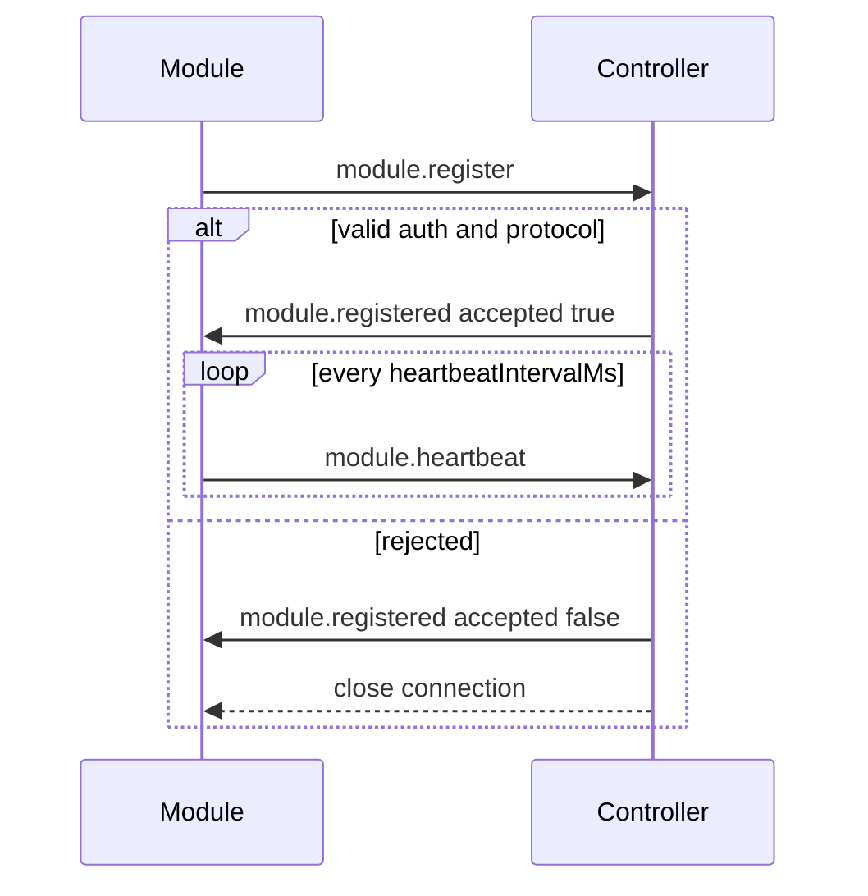

# ECHO WebSocket Protocol (v1)

Protocol version constant: **`1`** (`PROTOCOL_VERSION` in `@echo/protocol`).

All frames are JSON objects validated against the **envelope** schema. Binary payloads are not used in v1 except as future extensions announced out-of-band.

## Endpoints

| Path | Client | Purpose |
|------|--------|---------|
| `/ws/modules` | Capability modules | Registration, heartbeats, requests/responses |
| `/ws/dashboard` | Web UI | Push `system.snapshot` updates |

HTTP: `/health`, `/api/v1/status` (snapshot pull).

## Envelope

Every message:

| Field | Required | Description |
|-------|----------|-------------|
| `protocolVersion` | yes | Must be `"1"` |
| `type` | yes | Message type string |
| `messageId` | yes | UUID |
| `correlationId` | no | Links response to request |
| `source` | yes | Module or controller id |
| `destination` | no | Target id when routed |
| `timestamp` | yes | ISO 8601 |
| `sessionId` | no | Conversation session |
| `taskId` | no | Long-running task id |
| `payload` | yes | Type-specific body |
| `error` | no | Structured error |

## Message categories

### Lifecycle

- `module.register` — Module → Controller. Payload: registration (id, name, version, capabilities, host, optional `authToken`).
- `module.registered` — Controller → Module. Payload: `accepted`, heartbeat intervals, `reason` if rejected.
- `module.deregister` — Reserved for graceful leave.

### Health

- `module.heartbeat` — Module → Controller. Payload: `{ moduleId, sequence? }`.
- `module.health` — Module → Controller. Payload: status `ready|busy|degraded|unavailable`, optional load.

Controller marks modules **degraded** if heartbeats exceed `heartbeatTimeoutMs`.

### Capabilities

- `capability.list` / `capability.update` — Reserved for dynamic capability changes post-registration.

### Work

- `request` — Controller → Module. Payload: `{ capabilityId, method?, params?, timeoutMs? }`.
- `response` — Module → Controller. Payload: `{ capabilityId, result?, error? }`.
- `stream.chunk` / `stream.end` — Incremental capability output (correlated to `request.messageId`). Used for LLM token streaming.
- `task.update` — Progress for long tasks.
- `cancel` — Cancel by `taskId` or correlated request.

### Events

- `event.publish` — Module → Controller. Payload: `{ eventType, priority, data }`. Priorities: `immediate`, `interrupt`, `background`, `low`.

### Other

- `config.update`, `error`, `log`, `controller.ack` — Operational and diagnostics.

## Registration flow



## Reliability semantics

- WebSocket delivery is **best-effort**. No exactly-once guarantee.
- **Heartbeats** are advisory; controller state drives operator visibility.
- **Requests** should be idempotent where retry is possible; use explicit `taskId` for long work.
- On module disconnect, in-flight tasks for that module **fail** unless a module implements recovery (future).
- Max message size: **512 KiB** (controller rejects larger).
- Modules should reconnect with **exponential backoff + jitter** (implemented in `@echo/module-sdk`).

## Authentication (Phase 1)

If the controller config sets `moduleAuthToken` (or `ECHO_MODULE_AUTH_TOKEN`), registration payload must include matching `authToken`. Phase 6 will add pairing and TLS/WSS.

## Dashboard feed

Server → browser JSON (not full envelope):

```json
{ "type": "system.snapshot", "data": { "controllerId", "uptimeSeconds", "persona", "modules", "recentEvents" } }
```

## Versioning

Breaking envelope or lifecycle changes increment `PROTOCOL_VERSION`. Modules declare supported protocol at register; controller rejects mismatches.
